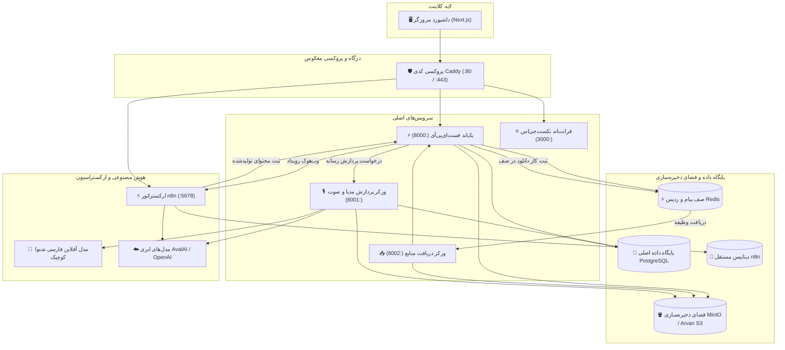

<p align="center">
  
</p>

<p align="center">
  <strong>موتور هوشمند تبدیل خودکار محتوای چندرسانه‌ای. تبدیل ویدیوهای طولانی، پادکست‌ها، ویدیوهای یوتیوب و ریلزهای اینستاگرام به مقالات تخصصی، اسلایدهای کروسل و پست‌های بهینه‌سازی‌شده برای شبکه‌های اجتماعی با ارکستراسیون خودکار n8n.</strong>
</p>

<p align="center">
  <a href="README.md"><strong>English</strong></a> •
  <a href="README.fa.md"><strong>فارسی</strong></a>
</p>

<p align="center">
  
  
  
  
  
  
  
</p>

---

## 📑 فهرست مطالب

- [معرفی پروژه](#-معرفی-پروژه)
- [ویژگی‌های کلیدی](#-ویژگیهای-کلیدی)
- [معماری سیستم](#-معماری-سیستم)
- [استک فنی](#-استک-فنی)
- [تصاویر محیط برنامه](#-تصاویر-محیط-برنامه)
- [کاربردها و ارزش افزوده](#-کاربردها-و-ارزش-افزوده)
- [شروع سریع](#-شروع-سریع)
  - [پیش‌نیازها](#پیشنیازها)
  - [مراحل راه‌اندازی](#مراحل-راهاندازی)
- [تنظیمات متغیرهای محیطی](#-تنظیمات-متغیرهای-محیطی)
- [راهنمای استقرار در سرور ابری (VPS)](#-راهنمای-استقرار-در-سرور-ابری-vps)
- [تست‌ها](#-تستها)
- [مسیر توسعه (Roadmap)](#-مسیر-توسعه-roadmap)
- [مشارکت در پروژه](#-مشارکت-در-پروژه)
- [امنیت](#-امنیت)
- [مجوز](#-مجوز)
- [نویسنده و تقدیر و تشکر](#-نویسنده-و-تقدیر-و-تشکر)

---

## 🌟 معرفی پروژه

تولید محتوای دست‌اول تنها نیمی از مسیر بازاریابی محتوایی است. برای دستیابی به حداکثر اثرگذاری و مخاطب، هر ویدیوی آموزشی، وبینار، مصاحبه یا پادکست باید بازآفرینی شده و در قالب‌های گوناگون متناسب با هر پلتفرم منتشر شود: مقالات جامع سئو برای وب‌سایت، رشته‌توییت‌های جذاب برای توییتر/X، پست‌های تحلیلی و تخصصی برای لینکدین، خلاصه پیام‌ها برای کانال‌های تلگرام و کروسل‌های چنداسلایدی تصویری برای اینستاگرام.

انجام دستی این فرآیند مستلزم صرف ساعت‌ها زمان برای پیاده‌سازی متن، خلاصه‌نویسی، کپی‌رایتینگ و فرمت‌بندی است.

**پلتفرم بازآفرینی محتوا (Content Repurposing Platform)** یک سیستم جامع، متن‌باز و سازمانی است که کل این زنجیره را به صورت خودکار مدیریت می‌کند:
1. **دریافت چندرسانه‌ای**: امکان آپلود مستقیم فایل‌های سنگین، دانلود امن ویدیوهای یوتیوب (با دور زدن محدودیت‌های ربات) و ریلزهای اینستاگرام.
2. **تبدیل گفتار به متن (STT)**: پیاده‌سازی گفتار فارسی با استفاده از مدل کاملاً **آفلاین و محلی** شنوا کوچیک (FastConformer ONNX) یا سرویس‌های ابری نظیر اول‌بل (AvalAI) و ویسپر OpenAI همراه با برچسب‌های زمانی دقیق.
3. **استخراج هسته محتوایی (Canonical Knowledge)**: استخراج مفاهیم کلیدی، نقل‌قول‌ها، ایده‌های اصلی و لحن مخاطب در قالب یک ساختار دانش متمرکز.
4. **بازتولید چندپلتفرمی**: ایجاد خودکار محتوا متناسب با ساختار هر شبکه اجتماعی از طریق ورک‌فلوهای بصری **n8n** و بازگشت نتایج آماده انتشار به داشبورد وب.

---

## 📸 گالری تصاویر سیستم

| **داشبورد مدیریت پروژه‌ها** | **فضای کاری پروژه و منابع ورودی** |
|:---:|:---:|
|  |  |
| *داشبورد چندپروژه‌ای با وضعیت‌های زنده و طراحی مدرن دارک* | *مدیریت یکپارچه منابع ورودی، خط لوله چندرسانه‌ای و خروجی‌ها* |

| **تنظیمات دور زدن محدودیت یوتیوب** | **تولید محتوای هوشمند چندکاناله** |
|:---:|:---:|
|  |  |
| *مدیریت کوکی‌های نشست برای دور زدن خطای ربات در یوتیوب* | *انتخابگر هوشمند فرمت‌های خروجی (وبلاگ، تلگرام، کروسل و توییتر)* |

---

## ✨ ویژگی‌های کلیدی

### 📥 ۱. ورودی چندگانه رسانه
- **آپلود مستقیم فایل‌های حجیم**: استفاده از Presigned URLهای ذخیره‌سازی ابری S3/MinIO برای آپلود مستقیم چند گیگابایتی از مرورگر همراه با نوار پیشرفت.
- **موتور مقاوم یوتیوب**: مبتنی بر `yt-dlp` با پشتیبانی از خاتمه ایمن فرآیندها (`SIGTERM`/`SIGKILL`)، مکانیزم تلاش مجدد با تأخیر تصاعدی (Exponential Backoff) و پایش وضعیت نشست.
- **مدیریت کوکی‌های یوتیوب**: قابلیت بارگذاری فایل `cookies.txt` مرورگر از طریق پنل کاربری برای عبور ایمن از خطای *"Sign in to confirm you're not a bot"*.
- **زنجیره دانلود اینستاگرام**: پشتیبانی از دانلود خودکار ریلزها و پست‌ها با زنجیره پشتیبان (`parth-dl` ← `instaloader` ← `yt-dlp`).
- **ورودی متن مستقیم**: امکان الصاق متن مصاحبه‌ها، مقالات یا یادداشت‌ها برای بازتولید آنی.

### 🎙️ ۲. موتور دوگانه تبدیل گفتار به متن
- **موتور کاملاً آفلاین زبان فارسی**: ادغام مدل **شنوا کوچیک نسخه ۱.۵ (FastConformer RNNT)** بر بستر `sherpa-onnx`، با اجرای کاملاً محلی روی پردازنده اصلی (CPU) و در یک فرآیند ایزوله (`ProcessPoolExecutor`) بدون مسدودسازی GIL پایتون و بدون هیچ‌گونه هزینه API.
- **سرویس‌های ابری پیشرفته**: پشتیبانی از API ابری **AvalAI** (مدل‌های `scribe_v2` و `gpt-4o-transcribe`) و Whisper اوپن‌ای‌آی.
- **انتخاب ارائه‌دهنده برای هر پروژه**: امکان تغییر موتور تبدیل صوت به صورت مجزا در تنظیمات هر فضای کاری.
- **پیش‌پردازش و تقطیع صوتی**: نرمال‌سازی خودکار صدا به فرمت 16kHz Mono PCM WAV و قطعه‌بندی هوشمند فایل‌های بالای ۳ دقیقه برای بهینه‌سازی حافظه رم.

### 🧠 ۳. مغز پردازش و بازآفرینی محتوا
- **خلاصه‌سازی هسته‌ای (Canonical Content)**: ایجاد یک شاکله مفهومی استاندارد پیش از نگارش پست‌های نهایی.
- **خروجی‌های اختصاصی برای پلتفرم‌های مختلف**:
  - 📝 **مقاله وب‌سایت**: نگارش مقاله کامل و ساختاریافته به فرمت Markdown همراه با تیترها و جدول‌ها.
  - 💼 **پست لینکدین**: قلاب‌های جذاب (Hook)، فاصله‌گذاری استاندارد و ترغیب به تعامل (CTA).
  - 🧵 **رشته توییت**: قطعات کوتاه، گیرا و زنجیره‌ای مناسب اشتراک‌گذاری در X.
  - ✈️ **کانال تلگرام**: چیدمان خلاصه پیام با استفاده از بولت‌پوینت‌ها و هشتگ‌های مرتبط.
  - 🎨 **اسلایدهای کروسل اینستاگرام**: محتوای متنی اسلاید به اسلاید همراه با پرامپت تولید تصاویر متناسب با هر اسلاید.

### 🖥️ ۴. داشبورد و رابط کاربری مدرن
- **فضاهای کاری چندپروژه‌ای**: ایجاد، تغییر نام، حذف کامل پروژه با پاکسازی هماهنگ اشیاء در فضای S3.
- **پایش زنده وضعیت**: دریافت وضعیت پردازش بدون نیاز به رفرش دستی صفحه.
- **پیش‌نمایش زنده Markdown**: رندر سریع و خوانای مقالات و محتوا با تم تیره شکیل.

---

## 🏗️ معماری سیستم



---

## 🧰 استک فنی

| بخش | فناوری | نسخه | کاربرد |
|---|---|---|---|
| **بک‌اند وب** | [FastAPI](https://fastapi.tiangolo.com/) | `0.115.0` | فریم‌ورک سریع و ناهمگام REST API |
| **سرور ASGI** | [Uvicorn](https://www.uvicorn.org/) | `0.30.6` | سرور اجرایی ناهمگام |
| **دیتابیس اصلی** | [PostgreSQL](https://www.postgresql.org/) | `16-alpine` | منبع حقیقت داده‌ها با کلیدهای خارجی آبشاری |
| **ارتباط با دیتابیس**| [SQLAlchemy](https://www.sqlalchemy.org/) + [asyncpg](https://github.com/MagicStack/asyncpg) | `2.0.32` / `0.29.0` | مدیریت ارتباطات غیرهمگام با پایگاه داده |
| **صف پیام** | [Redis](https://redis.io/) | `7-alpine` | مدیریت صف‌های دانلود سنگین |
| **ارکستراسیون بصری**| [n8n](https://n8n.io/) | `latest` | مدیریت گراف‌های پردازشی و پرامپت‌های هوش مصنوعی |
| **ذخیره‌سازی ابری** | [MinIO](https://min.io/) / ابر آروان | S3 v4 | نگهداری ویدیوها، صوت‌ها و تصاویر تولیدشده |
| **تبدیل صوت آفلاین**| [sherpa-onnx](https://github.com/k2-fsa/sherpa-onnx) | `1.13.6` | پردازش آفلاین مدل فست‌کانفورمر فارسی شنوا |
| **پردازش رسانه** | [FFmpeg](https://ffmpeg.org/) / FFprobe | System | استخراج صدا، نرمال‌سازی و قطعه‌بندی |
| **دانلودر یوتیوب** | [yt-dlp](https://github.com/yt-dlp/yt-dlp) | `2024.8.6` | دانلود پایدار فایل صوتی یوتیوب همراه کوکی |
| **فرانت‌اند** | [Next.js](https://nextjs.org/) + React | `15.x` | رابط کاربری و داشبورد تعاملی |
| **استایل‌دهی** | [TailwindCSS](https://tailwindcss.com/) | `4.x` | طراحی واکنش‌گرا با تم تیره مدرن |
| **پروکسی معکوس** | [Caddy](https://caddyserver.com/) | `2-alpine` | مدیریت خودکار SSL/TLS و هدایت ترافیک |

---

## 📸 تصاویر محیط برنامه

| ۱. داشبورد مدیریت پروژه‌ها | ۲. فضای کاری و بارگذاری رسانه |
| :---: | :---: |
|  |  |
| *مدیریت فضاهای کاری مستقل و بررسی وضعیت پیشرفت* | *آپلود مستقیم ویدیو، ثبت آدرس و متن خام* |

| ۳. تنظیمات کوکی یوتیوب | ۴. پیش‌نمایش خروجی‌های تولیدشده |
| :---: | :---: |
|  |  |
| *بارگذاری کوکی مرورگر و تست پایداری ارتباط با یوتیوب* | *بررسی، ویرایش و کپی‌کردن متن مقالات و پست‌ها* |

---

## 🚀 شروع سریع

### پیش‌نیازها
- نصب [Docker](https://docs.docker.com/get-docker/) و [Docker Compose](https://docs.docker.com/compose/)
- حداقل ۴ گیگابایت حافظه رم (در صورت استفاده از تبدیل گفتار آفلاین محلی)
- ابزار Git

### مراحل راه‌اندازی

#### ۱. کلون کردن مخزن
```bash
git clone https://github.com/Mahdi-Soleimani/content-repurposing.git
cd content-repurposing
```

#### ۲. ساخت فایل تنظیمات محیطی
```bash
cp .env.example .env
```
فایل `.env` را باز کرده و در صورت تمایل کلیدهای API سرویس‌های ابری خود (نظیر AvalAI یا OpenAI) را وارد کنید.

#### ۳. دریافت وزن‌های مدل آفلاین فارسی (اختیاری)
اگر مایلید تبدیل گفتار به صورت ۱۰۰٪ آفلاین و رایگان در سیستم خودتان اجرا شود:
```bash
./scripts/download_models.sh
```

#### ۴. اجرای سرویس‌ها با داکر
```bash
docker compose up --build -d
```

پس از بالا آمدن کانتینرها، بخش‌های مختلف در دسترس خواهند بود:
- **داشبورد کاربری**: [http://localhost](http://localhost) (یا پورت ۳۰۰۰)
- **مستندات تعاملی API**: [http://localhost:8000/docs](http://localhost:8000/docs)
- **محیط گرافیکی n8n**: [http://localhost:5678](http://localhost:5678)
- **کنسول MinIO**: [http://localhost:9001](http://localhost:9001)

#### ۵. ایمپورت ورک‌فلو در n8n
1. وارد n8n به آدرس `http://localhost:5678` شوید.
2. در اولین ورود، حساب کاربری مدیر را ایجاد کنید.
3. از منوی **Workflows** گزینه **Import from File** را انتخاب کنید.
4. فایل `Content repurposing.json` را از ریشه مخزن انتخاب کرده و جریان کاری را فعال (Active) کنید.

---

## 🌐 راهنمای استقرار در سرور ابری (VPS)

برای اجرای پایدار روی سرور لینوکس ابری (مانند اوبونتو ۲۲.۰۴ یا ۲۴.۰۴):

۱. **فایروال (UFW)** را تنظیم کنید تا فقط پورت‌های ۲۲، ۸۰ و ۴۴۳ باز باشند:
```bash
sudo ufw allow 22/tcp
sudo ufw allow 80/tcp
sudo ufw allow 443/tcp
sudo ufw enable
```

۲. **دامنه** خود را به آدرس IP سرور متصل کنید.

۳. در فایل `docker/caddy/Caddyfile`، مقدار دامنه را قرار دهید:
```caddy
crp.yourdomain.com {
    handle /api/* {
        reverse_proxy api:8000
    }
    handle /webhook/* {
        reverse_proxy n8n:5678
    }
    handle {
        reverse_proxy web:3000
    }
}
```
وب‌سرور Caddy به صورت خودکار گواهی رایگان Let's Encrypt SSL را دریافت و تمدید خواهد کرد!

---

## 🧪 تست‌ها

برای اجرای تست‌های واحد بخش دانلودر:
```bash
cd services/source-worker
python -m pytest tests/test_youtube_downloader.py -v
```

---

## 🤝 مشارکت در پروژه

از هرگونه مشارکت، گزارش باگ یا پیشنهاد ویژگی جدید استقبال می‌کنیم. لطفاً پیش از ارسال پول ریکوئست، [راهنمای مشارکت](CONTRIBUTING.md) و [مرام‌نامه اخلاقی](CODE_OF_CONDUCT.md) را مطالعه فرمایید.

---

## 📄 مجوز

این پروژه تحت مجوز **MIT** منتشر شده است. برای اطلاعات بیشتر فایل [`LICENSE`](LICENSE) را مشاهده کنید.

---

## 🙏 نویسنده و تقدیر و تشکر

- **مهدی سلیمانی** — [گیت‌هاب (@Mahdi-Soleimani)](https://github.com/Mahdi-Soleimani)
- **تیم شنوا** — بابت انتشار متن‌باز مدل [شنوا کوچیک](https://huggingface.co/Reza2kn/Shenava-Koochik-v1.5-RNNT-sherpa-onnx) برای زبان فارسی.
- **جامعه n8n** — برای بستر قدرتمند اتوماسیون جریان‌های کاری.
